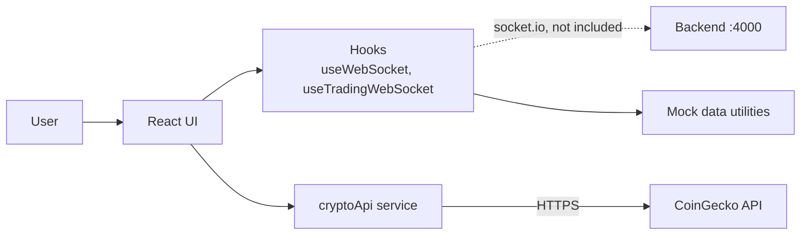

# BTC Tracker

A Bitcoin price dashboard front end built with Vite, React and TypeScript.

> **Status: early prototype.** Front end only. Some panels use mock data.

## What it does

- Fetches the live BTC price from the CoinGecko public API (cached, at most one request every 10 seconds)
- Displays trading and campaign-style tables and a region map from mock data
- Has a Socket.IO client wired to a back end at `http://localhost:4000`. That back end is **not included** in this repo.

## Tech stack

Vite, React, TypeScript, Tailwind CSS, socket.io-client

## Run locally

```bash
cd frontend
npm install
npm run dev
```

## Limitations

- No back end is included, so the socket features fall back to mock data.
- CoinGecko's free tier is rate limited.

## High-level design (HLD)



## Low-level design (LLD)

| Piece | Detail |
| --- | --- |
| `services/cryptoApi.ts` | `CryptoApiService.fetchBTCPrice()` calls CoinGecko, returns cached data if the last fetch was under 10 seconds ago, and keeps a price history |
| `socket.ts` | Single shared `socket.io-client` connection to `http://localhost:4000` |
| `hooks/useWebSocket.ts`, `hooks/useTradingWebSocket.ts` | Live data hooks that use the mock data utilities |
| `utils/mockTradingData.ts` | Mock trading data that feeds `CampaignTable` and `RegionMap` |
